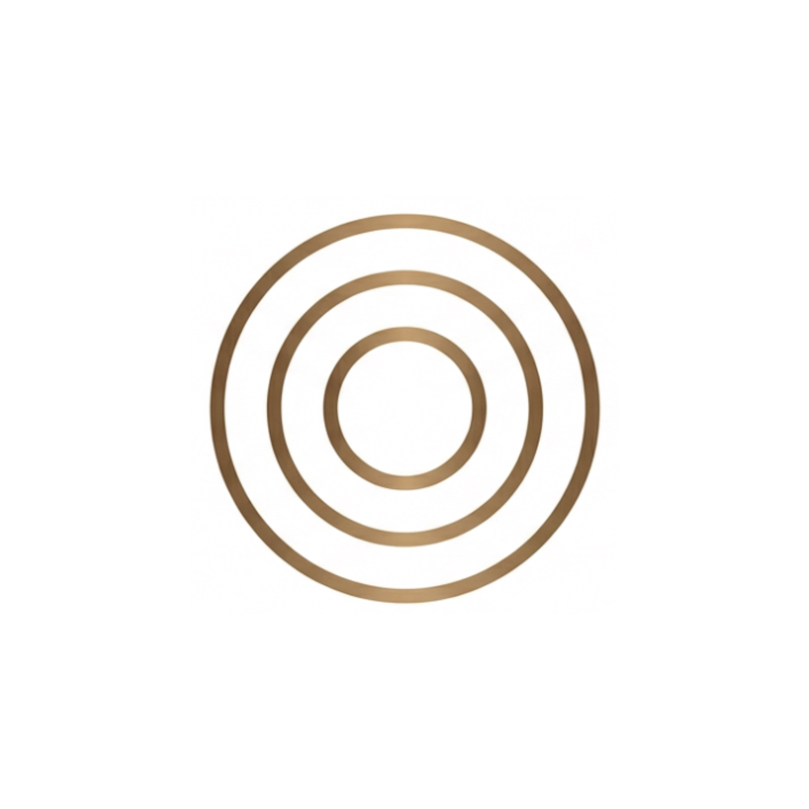
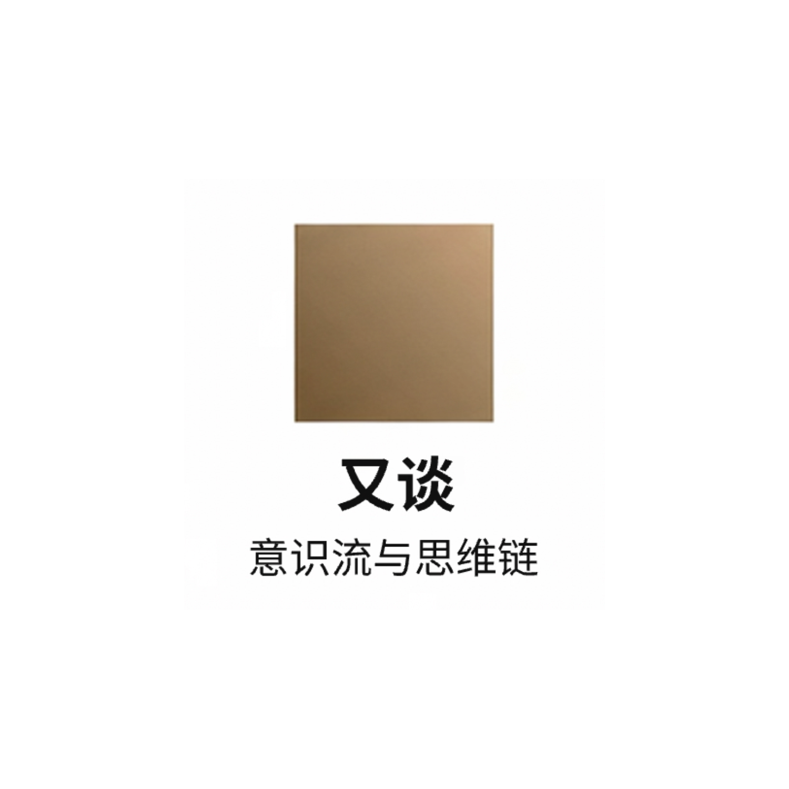
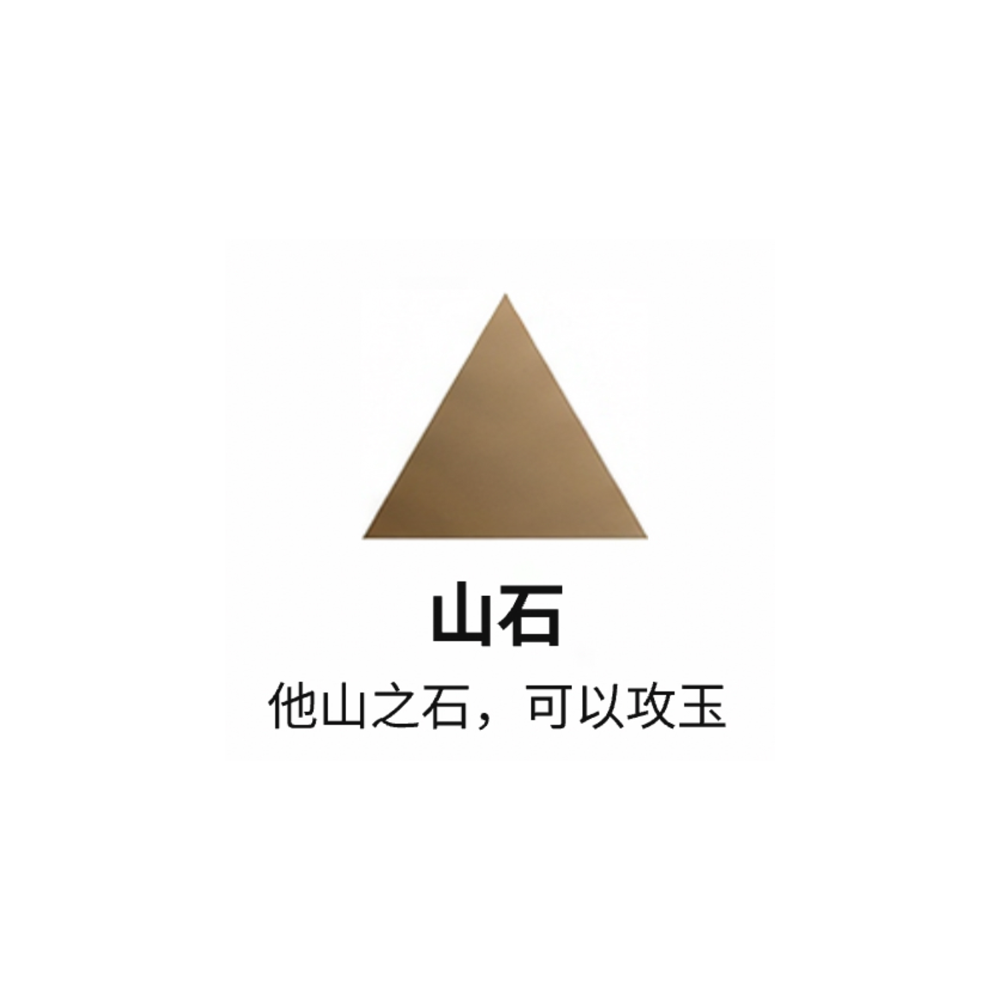
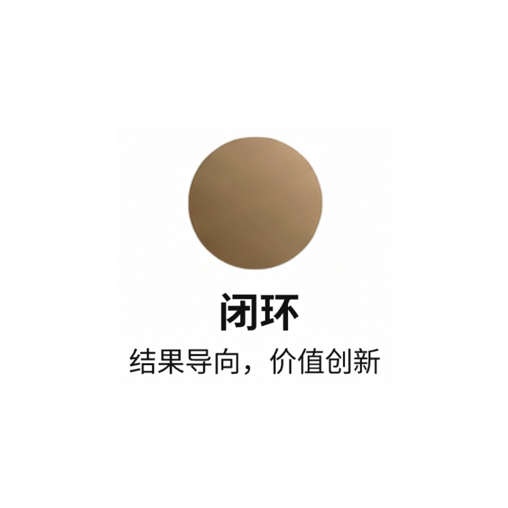

# 岁知社参考图索引

26 张原始参考图，文件名与字节保持不变。参考图用于风格研究；品牌署名使用独立 Logo。

## 岁知社_StyleRef_01_金色圆月 Large.jpeg

## 岁知社_StyleRef_02_山水一线 Large.jpeg

## 岁知社_StyleRef_03_笔触留白 Large.jpeg

## 岁知社_StyleRef_04_几何静穆 Large.jpeg

## 岁知社_StyleRef_05_月相渐变 Large.jpeg

## 岁知社_StyleRef_06_光影之门 Large.jpeg

## 岁知社_StyleRef_07_三角指月 Large.jpeg

## 岁知社_StyleRef_08_线性传承 Large.jpeg

## 岁知社_StyleRef_09_圆缺禅意 Large.jpeg

## 岁知社_StyleRef_10_水墨涟漪 Large.jpeg

## 岁知社中秋海报_重设计_A_月相双语 Large.jpeg

## 岁知社中秋海报_重设计_B_清光双语 Large.jpeg

## 岁知社每日海报_中文版_我害怕_v2 Large.jpeg

## 岁知社每日海报_中文版_第三组 Large.jpeg

## 岁知社每日海报_中文版_第二组 Large.jpeg

## 岁知社每日海报_英文版_IDread_v2 Large.jpeg

## 岁知社每日海报_英文版_第三组 Large.jpeg

## 岁知社每日海报_英文版_第二组 Large.jpeg

## 岁知社端午节海报_中文版 Large.jpeg

## 岁知社端午节海报_英文版 Large.jpeg

## 1.png

## 2.png

## 3.png

## 4.png

## 5.png

## 6.png

